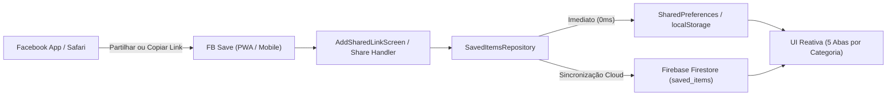

# DESIGN.md — Facebook Save Content (Shared Design System)

## 1. Visão Geral & Identidade Visual
**Facebook Save Content (`FB Save`)** é uma aplicação multiplataforma (Flutter Mobile + PWA iOS/Android/Desktop) concebida para funcionar como cofre pessoal e **Share Target** de conteúdos do Facebook (Posts, Imagens, Vídeos, Links e Comentários).

- **Estética:** Utilitária limpa, inspirada no ecossistema editorial e social moderno (Indigo/Facebook Blue com superfícies neutras de alto contraste para leitura confortável).
- **Plataformas Alvo:**
  - **iOS Safari PWA (`standalone`):** Instalável no ecrã principal do iPhone (`https://fb-save-tiago.web.app`), com respeito integral pelas `SafeArea` (Dynamic Island / Notch e indicador Home inferior).
  - **Android & iOS Nativo:** Receção direta via folha de partilha nativa (*Share Sheet* / `ACTION_SEND` / `ShareExtension`).
  - **Web / Desktop:** Layout responsivo centrado com navegação rápida.

---

## 2. Arquitetura de Tokens Visuais (3 Camadas)

Seguindo a estrutura **Primitive → Semantic → Component**:

### 2.1 Camada 1: Tokens Primitivos (Valores Brutos)
| Token Primitivo | Valor Hex / Unidade | Descrição |
| :--- | :--- | :--- |
| `--color-indigo-50` | `#E8EAF6` | Índigo ultra-claro para fundos de ícones/avatares |
| `--color-indigo-500` | `#3F51B5` | Índigo principal (Material Indigo) |
| `--color-indigo-700` | `#303F9F` | Índigo escuro (estados *pressed* / barra de estado) |
| `--color-indigo-a200` | `#536DFE` | Índigo acentuado para destaques ativos |
| `--color-slate-50` | `#F8F9FA` | Cinza muito claro para fundo geral da aplicação |
| `--color-white` | `#FFFFFF` | Branco puro para cartões, modais e barras |
| `--color-slate-900` | `#1C1E21` | Cinza-carvão para texto principal |
| `--color-slate-600` | `#65676B` | Cinza médio para subtítulos, URLs e metadados |
| `--color-slate-300` | `#DADDE1` | Cinza claro para divisores e bordas de inputs |
| `--color-red-500` | `#FF5252` | Vermelho acentuado para ações destrutivas (eliminar) |
| `--color-green-600` | `#2E7D32` | Verde para confirmação de ações (`SnackBar`) |

### 2.2 Camada 2: Tokens Semânticos (Propósito)
| Token Semântico | Referência Primitiva | Utilização |
| :--- | :--- | :--- |
| `color.brand.primary` | `--color-indigo-500` (`#3F51B5`) | Cor temática principal, `AppBar`, `manifest.json` |
| `color.brand.accent` | `--color-indigo-a200` (`#536DFE`) | Aba selecionada na `BottomNavigationBar`, foco de inputs |
| `color.bg.canvas` | `--color-slate-50` (`#F8F9FA`) | Fundo do `Scaffold` das listas |
| `color.bg.surface` | `--color-white` (`#FFFFFF`) | Superfície de `Card`, `Dialog` e `BottomNavigationBar` |
| `color.bg.badge` | `--color-indigo-50` (`#E8EAF6`) | Fundo de `CircleAvatar` nos itens sem miniatura |
| `color.text.primary` | `--color-slate-900` (`#1C1E21`) | Títulos de posts, conteúdo textual principal |
| `color.text.secondary` | `--color-slate-600` (`#65676B`) | URLs, categorias, estado vazio (*empty state*) |
| `color.border.default` | `--color-slate-300` (`#DADDE1`) | Bordas de `OutlinedInputBorder` no formulário |
| `color.status.danger` | `--color-red-500` (`#FF5252`) | Ícone de eliminar item (`Icons.delete_outline`) |

### 2.3 Camada 3: Tokens de Componentes
| Componente | Token de Componente | Valor / Mapeamento |
| :--- | :--- | :--- |
| **AppBar** | `appbar.bg` / `appbar.fg` | `color.brand.primary` / `--color-white` |
| **BottomNav** | `nav.selected` / `nav.unselected` | `color.brand.accent` / `color.text.secondary` |
| **Item Card** | `card.bg` / `card.elevation` / `card.radius` | `color.bg.surface` / `1dp` / `8px` |
| **Thumbnail** | `thumb.size` / `thumb.radius` | `56x56px` / `6px` |
| **FAB** | `fab.bg` / `fab.fg` | `color.brand.accent` / `--color-white` |
| **Form Input** | `input.border.radius` / `input.padding` | `8px` / `16px` |

---

## 3. Tipografia & Escala Tipográfica

A aplicação utiliza a fonte nativa de cada plataforma para máxima legibilidade e zero latência de carregamento (`SF Pro Text / Display` em iOS/Safari, `Roboto` em Android/Windows).

| Estilo / Papel | Tamanho (`sp`/`px`) | Peso | Altura de Linha | Cor Semântica |
| :--- | :--- | :--- | :--- | :--- |
| **AppBar Title** | `18px` | `600` (Semi-Bold) | `24px` (`1.33`) | `--color-white` |
| **Card Title / Post** | `16px` | `500` (Medium) | `22px` (`1.37`) | `color.text.primary` (máx. 2 linhas, `ellipsis`) |
| **Card Subtitle / URL** | `14px` | `400` (Regular) | `20px` (`1.42`) | `color.text.secondary` (máx. 1 linha, `ellipsis`) |
| **Button / FAB Label** | `16px` | `600` (Semi-Bold) | `20px` (`1.25`) | `--color-white` |
| **BottomNav Label** | `12px` | `500` (Medium) | `16px` (`1.33`) | `nav.selected` / `nav.unselected` |
| **Empty State Text** | `15px` | `400` (Regular) | `22px` (`1.46`) | `color.text.secondary` |

---

## 4. Hierarquia Espacial, Grelha e Regras de Layout

### 4.1 Escala de Espaçamento (Base `4px`)
- `space-1` (`4px`): Espaçamento mínimo entre ícone e rótulo.
- `space-2` (`8px`): Separação vertical entre cartões na lista (`ListView.separated`).
- `space-3` (`12px`): Padding exterior da lista de cartões (`EdgeInsets.all(12)`).
- `space-4` (`16px`): Padding de formulários (`AddSharedLinkScreen`) e espaçamento entre campos.
- `space-6` (`24px`): Separação antes do botão de ação principal ("Guardar").

### 4.2 Estrutura de Ecrã e Safe Areas (iPhone PWA)
1. **Topo (`AppBar`):** Mostra sempre o contexto ativo (`FB Save • Posts`, `FB Save • Links`, etc.) e o botão de autenticação Facebook quando não autenticado.
2. **Corpo (`SafeArea` + `Scaffold`):**
   - Lista vertical contínua com `ListView.separated`.
   - Estado vazio centrado verticalmente com ícone `Icons.bookmark_border` (`48px`), título e instrução clara.
3. **Ação Flutuante (`FloatingActionButton.extended`):**
   - Posicionado no canto inferior direito (`+ Guardar`), acima da barra de navegação.
   - Abre o ecrã `AddSharedLinkScreen` pré-selecionado na categoria da aba atual.
4. **Navegação Inferior (`BottomNavigationBarType.fixed`):**
   - 5 destinos fixos sempre visíveis:
     1. **Posts** (`Icons.article`)
     2. **Imagens** (`Icons.image`)
     3. **Vídeos** (`Icons.videocam`)
     4. **Links** (`Icons.link`)
     5. **Comentários** (`Icons.comment`)

---

## 5. Especificação de Componentes e Estados de Interação

### 5.1 Cartão de Conteúdo (`_buildItemTile`)
- **Leading (Esquerda):**
  - Se `type == 'image'` e tiver URL válido: Miniatura `Image.network` (`56x56px`, `BoxFit.cover`, `borderRadius: 6px`) com `errorBuilder` de fallback para ícone.
  - Outros tipos: `CircleAvatar` com fundo `color.bg.badge` e ícone da categoria em `color.brand.primary`.
- **Conteúdo Central:**
  - `title`: Título extraído via OpenGraph (`og:title`), nota personalizada ou texto do post.
  - `subtitle`: URL original ou descrição secundária.
- **Trailing (Direita):**
  - Botão `Icons.open_in_new`: Visível quando existe URL; abre o link diretamente na app do Facebook ou navegador externo (`LaunchMode.externalApplication`).
  - Botão `Icons.delete_outline`: Remove imediatamente o registo do armazenamento local e do Firestore.

### 5.2 Formulário de Adição / Partilha (`AddSharedLinkScreen`)
- **Seletor de Categoria (`DropdownButtonFormField`):** Permite escolher ou alterar entre *Link*, *Post / Texto*, *Imagem (URL)*, *Vídeo (URL)* e *Comentário*.
- **Campo URL (`TextField`):** Teclado otimizado para URLs (`TextInputType.url`), com extração automática de metadados OpenGraph (`og:title`, `og:description`, `og:image`, `og:video`) com *timeout* de 4 segundos e *fallback* gracioso quando o Facebook bloqueia CORS no browser.
- **Campo Título / Nota (`TextField`):** Multilinha (3 linhas) para colar texto de posts, comentários ou notas pessoais.

---

## 6. Arquitetura de Fluxo UX & Persistência Híbrida

1. **Entrada via Share Target (Nativo & Web):**
   - **Android/iOS Nativo:** Recebe `Intent.ACTION_SEND` / `NSExtensionItem` pelo canal `com.example.facebook_save/share`.
   - **Web / PWA (`manifest.json`):** Suporta `share_target` e parâmetros de query (`/?url=...&text=...&title=...`), abrindo automaticamente o ecrã de adição preenchido.
2. **Offline-First & Resiliência:**
   - Todos os itens são gravados instantaneamente no dispositivo (`SharedPreferences` / `localStorage`) e sincronizados em segundo plano com o Cloud Firestore (`saved_items`), garantindo zero perda de dados mesmo offline ou sem sessão iniciada.
